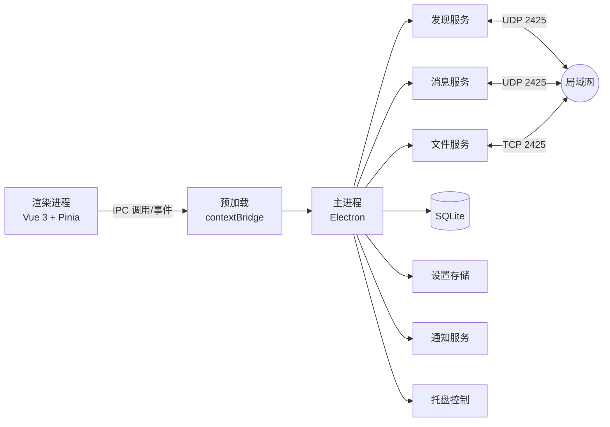
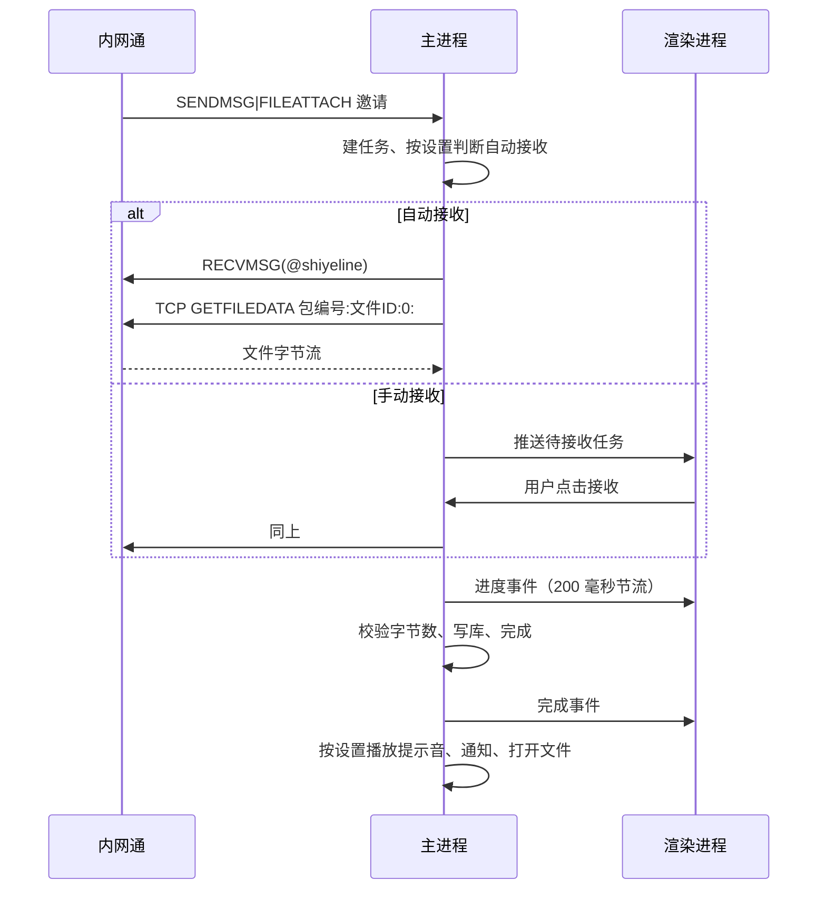
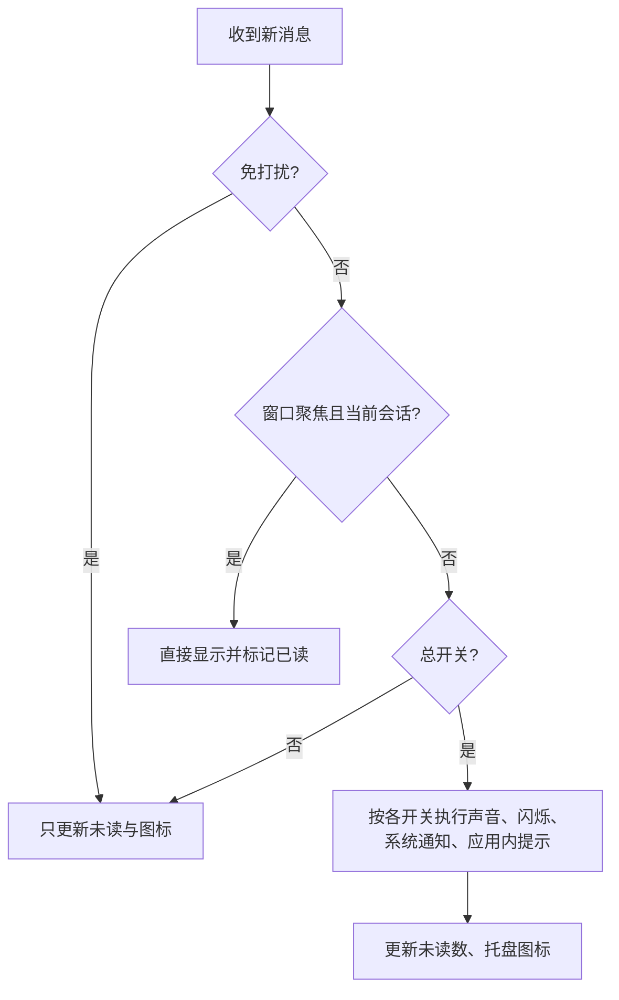

# 内网传书（Lanpost-IM）Electron 客户端重构设计

- 日期: 2026-10-23
- 状态: 待确认
- 项目名称: 内网传书（Lanpost-IM）
- 一句话简介: 基于 IPMSG 的跨平台局域网即时通信，无需服务器，文字与文件直传。

## 1. 背景

现有 Go 客户端已经与内网通 3.4.3055 实测互通：发现、在线状态、文字消息、双向文件、同名去重、83 MB 大文件。界面是 Go 进程内的网页面板，通过浏览器访问。

本次重构把整个客户端迁移到 Electron + Vue 3 + TypeScript，用桌面窗口替代浏览器，同时补齐长期使用需要的能力：完整历史、完善的设置、文件接收策略、托盘常驻、消息提醒。Go 客户端保留为协议参考实现与互通测试对端。

## 2. 目标

1. Windows x64 与 Linux ARM64 提供一致的桌面应用。
2. 完整复刻现有互通行为，与真实内网通双向往来。
3. 所有消息历史持久保存，重启、升级后仍然存在，支持搜索与导出。
4. 设置中心分类清晰，选项持久化并即时生效；需要重启的选项明确提示。
5. 文件接收支持默认目录、自动接收、大小上限、完成后打开或者定位。
6. 托盘常驻，关闭窗口不退出；消息提醒支持声音、图标闪烁、系统通知、应用内提示，可以分别开关。
7. 界面参考微信桌面版的布局（导航栏、会话列表、聊天区），视觉细节按首版工作量裁剪，不做逐像素还原。

## 3. 非目标

- 群聊、群文件、共享文件柜、远程协助。私有通道的载荷加密没有还原，首版不实现；数据模型预留会话类型。
- 浏览器访问面板。新架构使用 IPC，不再提供 HTTP 接口。
- 云端同步、账号体系、自动更新服务。
- macOS 打包。
- 保留 Go 子进程。

反目标：

- 界面接近微信，但是消息历史丢失或者文件传输不稳定，视为失败。
- 只在两个新客户端之间互通、与真实内网通不通，视为失败。

## 4. 约束

- 报文兼容: UDP 2425、TCP 2425、GBK、版本号 `1`、`RECVMSG` 的 `@shiyeline` 与结尾 NUL、`GETFILEDATA` 的 `packetID:fileID:offset:`、按包编号匹配发送任务。
- 历史不可丢: 旧 `history.jsonl` 首次启动导入；之后每条消息写库成功才算发送或者接收完成。
- 数据库使用 Electron 内置的 `node:sqlite`，不依赖原生模块；Windows 与 Linux 分别出包。
- 单机只能运行一个实例，端口 2425 独占。

## 5. 技术选型

| 项 | 选择 | 理由 |
|---|---|---|
| 壳 | Electron（electron-vite 模板） | 跨平台窗口一致，官方提供 arm64 构建 |
| 渲染 | Vue 3 + TypeScript + Pinia | 组合式 API，类型完整 |
| 构建 | electron-vite + electron-builder | 主进程、预加载、渲染进程三入口，安装包 |
| 数据库 | node:sqlite（Electron 44 / Node 24，WAL） | 同步 API、事务、单文件、无需原生模块 |
| 编码 | iconv-lite | GBK 双向转换 |
| XML | fast-xml-parser | 私有消息解析 |
| 校验 | zod | 设置与 IPC 入参校验 |
| 图标 | lucide-vue-next | 线性图标，接近微信桌面版的观感 |
| 测试 | vitest + Playwright | 单元、集成、窗口冒烟 |
| 构建 | GitHub Actions | Windows x64 与 Linux ARM64 分开构建，产物随 Release 发布 |
| 样式 | 原生 CSS + CSS 变量 | 微信风格需要定制，避免组件库覆盖 |

不使用 Element Plus、Naive UI 这类整包组件库；弹窗、菜单、开关等基础组件自建，配合 `@vueuse/core`。

## 6. 进程架构



主进程负责所有网络、文件、数据库、托盘、通知。渲染进程只做展示与交互，通过预加载脚本暴露的 `window.api` 访问主进程。渲染进程开启 `sandbox`、`contextIsolation`，关闭 `nodeIntegration`。

主进程模块：

| 模块 | 职责 |
|---|---|
| `core/proto/packet.ts` | 报文头编解码、Legacy 判定、NUL 处理 |
| `core/proto/commands.ts` | 命令号与标志位常量 |
| `core/proto/xml.ts` | 私有 XML 消息类型与序列化 |
| `core/proto/attach.ts` | 附件表编解码 |
| `core/protocol/adapter.ts` | 协议适配接口与能力模型 |
| `core/protocol/adapters/nwt.ts` | 内网通兼容通道实现 |
| `core/net/discovery.ts` | UDP 套接字、广播、种子、应答、心跳、9011 信标 |
| `core/net/transport.ts` | 发送队列、广播地址 |
| `core/peer/registry.ts` | 联系人表、在线状态、资料更新 |
| `core/chat/send.ts` | 文字发送、回执、已读 |
| `core/file/manager.ts` | 任务队列、接收目录、去重、进度 |
| `core/file/server.ts` | TCP 2425 监听、GETFILEDATA 匹配 |
| `core/file/client.ts` | 主动拉取、超时、校验 |
| `core/store/db.ts` | 数据库连接、迁移 |
| `core/store/messages.ts` | 消息读写、分页、搜索 |
| `core/store/files.ts` | 文件任务持久化 |
| `core/settings/store.ts` | 设置读写、默认值、迁移 |
| `core/notify/` | 系统通知、声音、闪烁、徽标 |
| `ipc/handlers.ts` | 通道注册、zod 校验、事件推送 |
| `window/main-window.ts` | 窗口、标题栏、关闭行为 |
| `window/tray.ts` | 托盘、菜单、单实例 |

## 7. 协议层

### 7.1 移植范围

以下模块按现有 Go 实现逐函数移植，行为保持一致：

- 报文头: `版本:序号:用户:主机:命令:正文`。Legacy 命令使用版本 `1`，私有命令使用 `1@shiyeline`。
- 命令号、标志位、附件位、UTF8 位。
- 发现: BR_ENTRY、ANSENTRY、广播间隔、种子地址、心跳、状态变化、退出。
- 文字: SENDMSG|SENDCHECK、RECVMSG 回执、已读回执、私有 XML 消息。
- 文件: 附件表、邀请、TCP 拉取、进度、完成。
- 编码: 入站按 UTF8 标志选择 UTF-8 或者 GBK；出站优先 GBK，失败时使用 UTF-8 并置位。

### 7.2 已经验证的细节

这些细节在 Go 版本上实测通过，TypeScript 版本按同样方式处理：

1. 拉取请求的版本号必须是不带后缀的 `1`。
2. 扩展域是 `包编号:文件ID:偏移:`，包编号取邀请消息的 UDP 序号，全部十六进制，结尾带冒号。
3. TCP 服务端按包编号匹配，不依赖对方回传的文件 ID。
4. 拉取之前发送一条 `1@shiyeline:...:33:<十进制包编号>\x00` 的 RECVMSG。
5. TCP 读取首字节超时 3 秒，后续字节空闲 300 毫秒视为请求结束。
6. 同名文件保存为 `名称 (1).扩展名`。

### 7.3 Node 实现的注意点

- `dgram` 绑定 2425 时设置 `reuseAddr: true`；Windows 上如果端口被内网通占用，启动时给出明确错误。
- `net.createServer` 绑定 2425；连接处理必须设置读取超时，避免半开连接堆积。
- 所有报文使用 `Buffer` 拼接，文本段用 `iconv-lite` 转换，禁止用字符串索引处理字节。
- 发送队列串行化，避免并发写同一个 UDP 套接字导致交错。
- 测试环境允许通过配置修改端口（例如 24250），生产环境固定 2425。

### 7.4 协议一致性测试

保留 Go 客户端作为参考对端：

- 在测试端口启动 Go 客户端（`--config` 指向测试配置），TypeScript 引擎与它互发 BR_ENTRY、文字、文件。
- 对每种报文比较线上字节与预期十六进制。
- 真实内网通回归清单在每个阶段结束执行一次。

### 7.5 消息状态机

| 状态 | 进入条件 | 界面 |
|---|---|---|
| `sending` | 写库之后、UDP 发送之前 | 发送中 |
| `sent` | UDP 写成功 | 已发送（单勾） |
| `delivered` | 收到对方的 RECVMSG 回执 | 已送达（双勾） |
| `read` | 收到私有 XML 已读回执 | 已读 |
| `failed` | UDP 写失败，或者重启时仍为 `sending` | 发送失败，可重试 |

- Legacy 文字只使用 `sent` 与 `delivered`，不把 `read` 当作必需状态。
- 真实内网通忽略私有 XML 已读回执，对 legacy 消息不发送已读回执；`read` 只在私有通道的客户端之间生效。
- 不设置自动重发。没有收到回执时消息保持 `sent`，用户可以在消息菜单里手动重新发送。
- 入站消息保存对方的 UDP 序号到 `remote_seq`，用于回执与排查。

### 7.6 自有协议扩展

现有的一对一发现、文字、文件继续与内网通互通。后续的群聊、群文件、输入状态等能力使用我们自己的扩展协议，不要求内网通兼容。

- 协议适配层: 定义 `ProtocolAdapter` 接口（发现、发送文字、发送文件、能力集合），首版实现 `NwtIpmsgAdapter`。新增能力时增加适配器或者扩展命令，消息服务与界面不直接依赖报文细节。
- 能力协商: 私有握手 XML 增加 `proto` 与 `caps` 字段；双方都声明某个能力时才启用对应功能，对端没有声明时界面隐藏入口。
- 命令空间: 4000–4999 保留给自有扩展，正文统一为 `<X_EXT v="1" ...>` 这类带版本的信封；内网通收到未知命令会直接忽略。
- 消息标识: 扩展消息使用 UUID，接收方按 UUID 去重，避免重发导致重复消息。
- 群聊数据: `conversations.kind = 'group'`，成员表 `group_members` 预先建立；群消息沿用 `messages`，`conversation_id` 指向群会话。
- 群聊协议本身（建群、邀请、成员同步、消息扇出）在适配层与数据模型完成之后再定义，不进入首版实现。

## 8. 数据模型

数据库文件位于数据根目录（默认 `userData`）下的 `lanpost.db`，使用 Electron 内置的 `node:sqlite`（`DatabaseSync`），WAL 模式，`user_version` 迁移。设置文件 `settings.json` 与数据库放在同一个数据根目录。已接收文件使用绝对路径记录，切换数据根目录不会移动这些文件。

### 8.1 会话

```sql
CREATE TABLE conversations (
  id TEXT PRIMARY KEY,
  kind TEXT NOT NULL,            -- direct | group（预留）
  peer_key TEXT UNIQUE,          -- IP|账号
  title TEXT NOT NULL,
  avatar TEXT,
  pinned INTEGER NOT NULL DEFAULT 0,
  muted INTEGER NOT NULL DEFAULT 0,
  unread INTEGER NOT NULL DEFAULT 0,
  last_read_message_id INTEGER NOT NULL DEFAULT 0,
  draft TEXT NOT NULL DEFAULT '',
  last_message_at INTEGER NOT NULL DEFAULT 0,
  created_at INTEGER NOT NULL
);
```

`last_read_message_id` 用于重启后恢复未读分隔线与未读计数。

### 8.2 消息

```sql
CREATE TABLE messages (
  id INTEGER PRIMARY KEY AUTOINCREMENT,
  conversation_id TEXT NOT NULL REFERENCES conversations(id),
  direction TEXT NOT NULL,       -- in | out
  kind TEXT NOT NULL,            -- text | file | system
  text TEXT NOT NULL DEFAULT '',
  remote_seq INTEGER NOT NULL DEFAULT 0,
  status TEXT NOT NULL,          -- sending | sent | delivered | read | failed
  created_at INTEGER NOT NULL,
  meta TEXT NOT NULL DEFAULT '{}'
);
CREATE INDEX idx_messages_conv ON messages(conversation_id, id DESC);
CREATE INDEX idx_messages_time ON messages(created_at);
```

`meta` 保存文件组、回执、旧数据标识等扩展字段。

### 8.3 文件任务

```sql
CREATE TABLE file_tasks (
  id TEXT PRIMARY KEY,           -- in-1 / out-xxxx
  message_id INTEGER REFERENCES messages(id),
  conversation_id TEXT NOT NULL,
  direction TEXT NOT NULL,
  name TEXT NOT NULL,
  size INTEGER NOT NULL DEFAULT 0,
  mtime INTEGER NOT NULL DEFAULT 0,
  file_id TEXT NOT NULL DEFAULT '',
  packet_id INTEGER NOT NULL DEFAULT 0,
  path TEXT NOT NULL DEFAULT '',
  state TEXT NOT NULL,           -- waiting | offered | transferring | done | rejected | failed | canceled
  received INTEGER NOT NULL DEFAULT 0,
  error TEXT NOT NULL DEFAULT '',
  created_at INTEGER NOT NULL,
  updated_at INTEGER NOT NULL
);
```

文件任务持久化，重启后已经接收的文件仍然显示在会话里，可以直接打开。

### 8.4 联系人

```sql
CREATE TABLE peers (
  key TEXT PRIMARY KEY,
  ip TEXT NOT NULL,
  port INTEGER NOT NULL,
  user TEXT NOT NULL,
  host TEXT NOT NULL,
  name TEXT NOT NULL,
  group_name TEXT NOT NULL DEFAULT '',
  corporation TEXT NOT NULL DEFAULT '',
  department TEXT NOT NULL DEFAULT '',
  sign TEXT NOT NULL DEFAULT '',
  status INTEGER NOT NULL DEFAULT 0,
  corp_id TEXT NOT NULL DEFAULT '',
  online INTEGER NOT NULL DEFAULT 0,
  ready INTEGER NOT NULL DEFAULT 0,
  legacy INTEGER NOT NULL DEFAULT 0,
  alias TEXT NOT NULL DEFAULT '',
  last_seen INTEGER NOT NULL DEFAULT 0
);
```

联系人资料以磁盘为准，在线状态由发现服务覆盖。别名只在本地生效。

### 8.4.1 群成员

```sql
CREATE TABLE group_members (
  conversation_id TEXT NOT NULL REFERENCES conversations(id),
  peer_key TEXT NOT NULL,
  role TEXT NOT NULL DEFAULT 'member',
  joined_at INTEGER NOT NULL,
  PRIMARY KEY (conversation_id, peer_key)
);
```

首版没有群聊入口，这张表为空；群聊协议实现后直接使用。

### 8.5 搜索

首版使用 `LIKE '%关键词%'` 扫描消息正文，按会话过滤后返回结果。FTS5 的 unicode61 分词不能命中中文子串，trigram 分词只支持三个字以上的查询，两字词（例如“文件”“消息”）会漏掉；在引入中文分词之前不做 FTS5 索引。数据量增大后再评估分词方案。

### 8.6 历史迁移

首次启动时：

1. 读取旧数据目录的 `config.json`，映射到设置（名称、账号、主机、部门、签名、状态、端口、网段）。
2. 读取 `history.jsonl`，按 `peer` 建立会话，逐条写入 `messages`；旧 `id` 放入 `meta.legacy_id`；文件提示保留为文本消息。
3. 导入完成后在设置里显示“已导入 N 条历史”，旧文件改名备份（`history.jsonl.imported`），不删除。
4. 设置里的“从旧版导入”提供目录选择，可以再次导入。

自动探测目录按顺序尝试：

- 新应用可执行文件所在目录。
- `%APPDATA%\nwt`（Windows）或者 `~/.config/nwt`（Linux）。
- 用户主目录下的 `nwt`。
- 数据根目录。

探测命中的条件是同时存在 `config.json` 与 `history.jsonl`。没有命中时首次启动不导入，引导用户手动选择。

导入时原样保留文本，包含已经损坏的替换字符；迁移过程不做二次解码。

### 8.7 启动状态恢复

进程退出时可能留下中间状态，启动时执行一次清理：

| 遗留状态 | 处理 |
|---|---|
| 消息 `sending` | 改为 `failed`，界面显示“未发送”，可以手动重新发送 |
| 文件任务 `transferring` | 改为 `failed`，删除没有写完的半截文件 |
| 文件任务 `waiting` 或 `offered` | 保留；对方在线时可以接收或者重新发送 |
| 文件任务 `done` 但路径不存在 | 保留记录，打开时提示文件已经被移动或者删除 |

手动重新发送会插入一条新消息并使用新的序号，不复用原消息行，避免对端收到重复的同一序号。

## 9. 设置

存储: `userData/settings.json`，zod 校验，原子写入（临时文件 + rename），带 `version` 字段做迁移。渲染进程通过 IPC 读取，修改后主进程广播 `settings:changed`。

| 分类 | 字段 | 默认值 | 作用 |
|---|---|---|---|
| 账号 | displayName | 张三 | 显示名称 |
| 账号 | account | 当前用户 | 协议账号 |
| 账号 | hostName | 主机名 | 协议主机名 |
| 账号 | group | 空 | 分组 |
| 账号 | corporation | 空 | 公司 |
| 账号 | department | 空 | 部门 |
| 账号 | sign | 空 | 个性签名 |
| 账号 | status | 在线 | 在线、忙碌、离开 |
| 网络 | port | 2425 | 协议端口（重启生效） |
| 网络 | bindAddr | 0.0.0.0 | 监听地址（重启生效） |
| 网络 | subnets | 空 | 额外广播网段 |
| 网络 | seeds | 空 | 固定对端地址 |
| 网络 | broadcastInterval | 30 秒 | 发现广播间隔 |
| 消息 | notifyEnabled | 开 | 新消息提醒总开关 |
| 消息 | notifySound | 开 | 声音 |
| 消息 | soundFile | 内置 | 提示音 |
| 消息 | soundVolume | 70 | 音量 |
| 消息 | flashTaskbar | 开 | 任务栏与托盘闪烁 |
| 消息 | systemNotification | 开 | 系统通知 |
| 消息 | inAppToast | 开 | 应用内提示 |
| 消息 | dnd | 关 | 免打扰 |
| 消息 | dndStart | 22:00 | 免打扰开始 |
| 消息 | dndEnd | 08:00 | 免打扰结束 |
| 文件 | receiveDir | 下载/内网通 | 默认接收目录 |
| 文件 | autoAccept | 关 | 自动接收 |
| 文件 | autoAcceptMaxMB | 512 | 自动接收大小上限，0 表示不限 |
| 文件 | notifyOnComplete | 开 | 接收完成提醒 |
| 文件 | openAfterReceive | 关 | 完成后打开文件 |
| 外观 | fontSize | 14 | 消息字号 |
| 外观 | density | 标准 | 标准、紧凑 |
| 通用 | closeToTray | 开 | 关闭窗口最小化到托盘 |
| 通用 | startAtLogin | 关 | 开机启动 |
| 通用 | startMinimized | 关 | 启动时隐藏窗口 |
| 通用 | language | 简体中文 | 界面语言（首版只有中文） |
| 存储 | dataDir | userData | 数据根目录（数据库与设置，重启生效；切换时提供新建或者复制数据库） |
| 存储 | historyRetention | 永久 | 首版只做永久 |
| 关于 | version | — | 版本与协议说明 |

状态值与内网通的对应关系（0 在线、1 忙碌、2 离开）在实现阶段用对方界面核对一次，只调整常量。

## 10. 界面

### 10.1 窗口

- 默认 1080×720，最小 900×600，记住上次大小与位置。
- 使用系统标题栏与窗口按钮，不实现自绘标题栏，减少窗口拖拽、最大化、Linux 窗口管理器差异带来的工作量。
- 搜索框放在会话列表顶部，跟随微信桌面版的布局。

### 10.2 三栏


- 导航栏: 深色背景；顶部头像与在线状态，下面依次是聊天、联系人、文件；底部设置。未读用红点加数字。
- 会话列表: 搜索框、全部与未读切换、置顶会话、普通会话；每项显示头像、名称、最后一条消息、时间、未读数，选中项高亮。
- 聊天区: 会话标题栏（名称、在线状态、静音标记、搜索、更多）、消息区、输入区。
- 对方资料与本会话的文件记录放在“聊天信息”弹窗里，从标题栏的“更多”打开，不设常驻右侧栏。

### 10.3 消息区

- 日期分隔条；同一分钟内的消息合并显示时间。
- 对方消息靠左，头像在左；自己的消息靠右，头像在右。头像使用圆角方形。
- 气泡最大宽度 60%，支持长文本换行、链接识别。
- 文件消息使用卡片：文件图标、名称、大小、进度条、速度、状态、打开文件、打开文件夹、另存为。
- 图片文件也按文件卡片展示，不做缩略图。
- 系统消息（“对方已接收文件”）居中灰字。
- 未读分隔线：进入会话时标记已读，未读计数清零。
- 新消息到达且当前不在底部时，显示“有新消息”悬浮按钮。
- 消息操作使用右键菜单（复制、重新发送），不做悬浮工具栏。

### 10.4 输入区

- 多行输入，Enter 发送，Shift+Enter 换行。
- 工具栏只有文件按钮；表情使用系统输入法自带表情，不做内置表情面板。
- 拖拽文件到聊天区直接发送。
- 发送失败保留草稿并标红，可以重试。
- 草稿按会话持久化。

### 10.5 视觉

| 变量 | 取值 |
|---|---|
| 强调色 | #07C160 |
| 导航栏背景 | #2E2E2E |
| 页面背景 | #F5F5F5 |
| 会话列表背景 | #FFFFFF |
| 卡片背景 | #FFFFFF |
| 主文字 | #191919 |
| 次文字 | #999999 |
| 分割线 | #E7E7E7 |
| 自己气泡 | #95EC69 黑字 |
| 对方气泡 | #FFFFFF 黑字 |

- 圆角: 卡片 8，气泡 6，按钮 4；头像 4。
- Logo: ✉️ 信封图形，绿色圆角方形底、白色信封。窗口图标、安装包图标、托盘图标由同一份 SVG 导出，避免不同系统的 emoji 字体差异。
- 字体: 系统界面字体，中文优先 `Microsoft YaHei`、`PingFang SC`、`Noto Sans CJK SC`。
- 首版只做浅色主题，CSS 变量预留深色值，后续再切换。
- 不做消息入场动画、自定义滚动条与复杂阴影。

### 10.6 设置界面

设置使用主窗口内的整页覆盖层，左侧分类导航，右侧表单，顶部搜索设置项。修改即时保存，需要重启的项显示“重启生效”标记。底部提供“恢复默认”。不为设置单独创建 BrowserWindow。

### 10.7 联系人页

- 列出所有发现过的对端，在线的排在前面，支持按名称、账号、IP 搜索。
- 显示头像、名称、分组、部门、签名、在线状态、IP。
- 双击或者点击“发消息”进入会话。
- 右键菜单：编辑备注名、复制 IP。
- 备注名写入 `peers.alias`，会话标题优先使用备注名。

### 10.8 文件页

- 汇总所有文件任务，按时间倒序，支持筛选：全部、接收中、已接收、已发送、失败。
- 每条显示文件名、大小、方向、对端、时间、状态；操作包括打开文件、打开文件夹、另存为、重试、取消、删除记录。
- 删除记录只删除任务行，不删除磁盘文件；界面明确提示。
- 顶部显示本次运行的接收目录与“打开接收目录”。

### 10.9 搜索与导出

- 全局搜索: 顶部搜索框，跨全部会话搜索消息，结果显示会话名、消息片段、时间；点击跳转到对应消息并高亮。
- 会话内搜索: 聊天标题栏的搜索图标，只搜索当前会话，支持上一条与下一条。
- 导出: 会话右键菜单与设置“存储”分类提供导出；范围支持当前会话与全部会话；格式支持 JSON（包含文件任务元数据）与 TXT（纯聊天记录）；导出使用保存对话框。

## 11. 文件传输

### 11.1 接收流程



规则：

- 自动接收只对满足大小上限的文件生效；超过上限仍然显示接收按钮。
- 默认接收目录可以修改；目录不存在时自动创建。
- 文件名去掉路径分隔符与 `..`，保存路径必须落在接收目录内。
- 同名文件自动加 ` (n)`。
- 接收中卡片显示进度、百分比、实时速度（指数平滑），完成后只显示文件信息与操作按钮。
- 支持取消：中断 TCP 连接、删除未完成文件、任务状态改为 canceled。
- 同时进行的接收最多 3 个，其余排队。

### 11.2 发送流程

- 选择文件、拖拽、粘贴图片都构造同一个附件邀请。
- 一个消息携带多个文件时，附件表用 `\a` 分隔，共享包编号。
- 对方拉取时按包编号找到任务，流式发送。
- 发送中显示进度与速度；完成后显示“已发送”。
- 发送历史计入数据库。

### 11.3 文件操作

- 打开文件: `shell.openPath`。
- 打开文件夹: `shell.showItemInFolder`；Linux 上没有选中能力时退化为打开目录。
- 另存为: 保存对话框，复制到目标位置。
- 清理: 设置里提供“打开接收目录”。

## 12. 托盘、常驻、通知

### 12.1 托盘

- 图标: 信封图形；正常状态为绿色底白色信封，未读在右上角加红点，离线时灰度。
- 菜单: 打开主界面、状态（在线、忙碌、离开）、免打扰开关、设置、退出。
- 点击托盘图标: 显示并聚焦窗口；再次点击隐藏。
- 关闭按钮默认隐藏窗口；托盘“退出”才结束进程。
- 单实例锁: 第二次启动直接聚焦已有窗口。
- 开机启动: Windows 使用 `setLoginItemSettings`；Linux 写入 `~/.config/autostart/lanpost-im.desktop`。

### 12.2 提醒判定



- 自己的消息不触发提醒。
- 会话静音优先于全局设置。
- 系统通知点击后聚焦窗口并切到对应会话。
- 免打扰时段支持跨天（22:00–08:00）。
- 文件接收完成复用同一套提醒规则。

### 12.3 提醒效果

- 声音: 渲染进程用 `Audio` 播放内置 wav 或者用户选择的文件；音量 0–100。窗口设置 `autoplayPolicy: no-user-gesture-required`。
- 闪烁: `win.flashFrame(true)`；窗口获得焦点后停止；托盘图标在正常与未读之间每 600 毫秒切换，持续 6 秒后停在未读图标。
- 系统通知: Electron `Notification`，标题为发送者，正文为消息摘要；文件消息显示文件名。Windows 设置 AppUserModelID。
- 应用内提示: 窗口可见但未聚焦时，右下角弹出 toast；点击跳转会话。
- 徽标: Linux 使用 `app.setBadgeCount`；Windows 使用托盘红点与任务栏闪烁，不做数字角标。

Linux 桌面没有通知守护进程或者托盘宿主时，设置页面显示检测结果，提醒降级为应用内提示。

## 13. 安全

- 渲染进程不接触 Node、文件系统、网络。
- 预加载只暴露白名单方法，通道名常量定义在共享类型里。
- 主进程对所有 IPC 入参做 zod 校验；文件路径只接受任务 ID，不接受任意路径。
- 禁止窗口导航到外部地址；外链用 `shell.openExternal`，并且只允许 http 与 https。
- 外部文件发送只接受用户通过对话框选择的路径或者拖拽产生的路径。
- 生产包关闭开发者工具与远程调试。

## 14. 兼容与迁移

- 旧客户端源码保留在 `client/`，作为协议参考与测试对端。
- 旧数据目录可以从设置里选择；默认查找同目录下的 `history.jsonl` 与 `config.json`。
- 迁移只读旧数据，不修改；导入完成后写一个标记文件。
- 协议文档 `docs/protocol.md` 作为实现依据，新增行为同步更新。

## 15. 构建与发布

- 开发: `pnpm dev` 启动 electron-vite 开发模式。
- CI: GitHub Actions，工作流文件 `.github/workflows/build.yml`。
- 触发: 推送 `v*` 标签与手动 `workflow_dispatch`。
- `windows` 任务: `runs-on: windows-latest`，Node 24 与 pnpm 12.15.0，执行 `pnpm install --frozen-lockfile`、类型检查、单元测试、`pnpm build:win`，上传安装包与免安装压缩包。
- `linux-arm64` 任务: `runs-on: ubuntu-24.04-arm`，执行同样的检查与 `pnpm build:linux`，上传 deb 与 AppImage。
- 两个任务都使用 Electron 内置的 `node:sqlite`，不需要原生编译工具链。
- 发布任务: 两个构建任务成功后，创建 GitHub Release，上传全部产物；版本号取自标签。
- arm64 托管 runner 目前处于公开预览，公开仓库可以直接使用；私有仓库没有该 runner 时改用自托管 ARM64 runner，或者 Docker buildx 加 QEMU 作为备选。
- Windows 构建不签名，安装时会出现 SmartScreen 提示；后续可以增加代码签名。
- 防火墙: NSIS 安装脚本添加 TCP 与 UDP 2425 的入站规则，需要管理员权限；静默安装时跳过，并在首次启动检测后提示。
- 产物: `lanpost-im-setup-<版本>.exe`、`lanpost-im-portable-<版本>.zip`、`lanpost-im_<版本>_arm64.deb`、`lanpost-im-<版本>-arm64.AppImage`。
- 应用标识: `productName: Lanpost-IM`，`appId: com.lanpost.im`，显示名称“内网传书”。
- 数据目录为 `userData`，不写安装目录。

## 16. 测试与验收

### 16.1 CI 自动化

- 单元: 报文编解码、GBK、附件表、文件名去重、设置 schema、数据库迁移、消息分页、中文搜索。
- 集成: 启动两个引擎实例（测试端口），互发文字与文件，校验状态与字节。
- 参考对端: 启动 Go 客户端，TypeScript 引擎与它互发，覆盖 BR_ENTRY、文字、文件邀请、拉取。
- 窗口冒烟: Playwright 启动 Electron，检查主窗口与设置；Linux 使用 xvfb，托盘与通知不在 CI 验证。
- 构建: Windows 与 Linux ARM64 两个任务各执行一次完整打包，产物上传到 Release。

### 16.2 发布验证（由用户执行）

真实内网通、托盘、通知、声音在目标机器上由用户验证。每个版本附带下面的清单：

1. 双方互相发现，名称、分组、签名正确。
2. 文字双向，回执显示“已送达”。
3. 小文件双向。
4. 大文件（≥ 80 MB）双向，字节数一致。
5. 同名文件接收两次，第二次保存为 `名称 (1).扩展名`。
6. 自动接收关闭时出现接收与拒绝；开启时按大小上限自动接收。
7. 窗口隐藏时收到消息，按设置播放声音、闪烁、弹出通知。
8. 关闭窗口后进程仍在托盘，重新打开窗口历史完整。
9. 重启应用后所有会话与消息仍在。
10. 从旧版导入历史，条数一致。

## 17. 实施阶段

| 阶段 | 内容 | 退出条件 |
|---|---|---|
| 0 | electron-vite 脚手架、窗口、托盘骨架、设置存储、SQLite 迁移框架、IPC 类型 | 窗口能启动，设置能保存，数据库能建表 |
| 1 | 协议编解码、发现、联系人、文字消息、历史库与旧数据导入 | 与 Go 参考对端互发文字；旧历史导入成功 |
| 2 | 文件邀请、TCP 服务、拉取、进度、去重、自动接收 | 与 Go 参考对端双向传文件；真实内网通双向通过 |
| 3 | 微信布局（简化）：导航栏、会话列表、聊天区、文件卡片、虚拟滚动 | 界面完整，长时间会话不卡顿 |
| 4 | 设置中心全部分类、托盘常驻、提醒效果、开机启动 | 设置项全部生效并持久化 |
| 5 | 打包、防火墙、图标、两平台构建、验收清单 | Windows 与 Linux ARM64 安装包可用 |

## 18. 风险与对策

| 风险 | 对策 |
|---|---|
| TypeScript 重写偏离线上行为 | Go 参考对端做协议一致性测试；每个阶段跑真实内网通清单 |
| Electron 升级后 node:sqlite 的 API 或 SQLite 版本变化 | 固定 Electron 版本；集成测试覆盖打开、迁移、中文搜索查询 |
| Linux 托盘与通知依赖桌面环境 | 启动检测，失败时降级并在设置里提示 |
| 2425 端口被内网通占用 | 启动明确报错；支持修改端口并在界面提示 |
| 历史数据库损坏 | WAL、事务、每日备份 `lanpost.db.bak`，保留最近 7 份 |
| GBK 转换丢字 | 出站 GBK 失败时置 UTF8 位；入站保留原始字节用于排查 |
| 大文件内存占用 | 全程流式读写，64 KB 缓冲，不把文件读入内存 |

## 19. 设计决定

以下是我的判断：

1. 数据库使用 `node:sqlite`（Electron 44 内置 Node 24，已经确认支持 WAL 与事务）；构建全部在 GitHub Actions 上执行，Windows 与 Linux ARM64 分开 runner。
2. 自动接收默认关闭，上限 512 MB（默认安全，用户可以打开）。
3. 首版只有一对一；群聊在数据模型里预留 `kind` 字段，协议层等私有通道还原后再做。
4. 旧历史自动导入一次，原文件改名备份，不删除；损坏的替换字符原样保留。
5. 状态值 0、1、2 对应在线、忙碌、离开，实现时与内网通界面核对。
6. 通知默认全开（声音、闪烁、系统通知、应用内提示），免打扰默认关闭。
7. 设置存储使用自管理的 JSON（zod 校验、原子写入），不引入 electron-store。
8. 界面使用自绘组件，不引入整包 UI 组件库。
9. Windows 与 Linux ARM64 都提供独立窗口与托盘；Linux 没有桌面环境时给出明确提示。
10. 切换数据根目录时提供两个选项：在新目录新建空库，或者复制现有数据库与设置过去；已接收文件不移动，继续使用原来的绝对路径。
11. 首次启动自动探测旧数据目录（可执行文件目录、`%APPDATA%\nwt`、`~/.config/nwt`、主目录下的 `nwt`、数据根目录），没有命中时引导手动选择。
12. 出站消息不自动重发；没有回执时保持 `sent`，手动重新发送会新建一行并使用新序号。
13. 启动时把遗留的 `sending` 消息与 `transferring` 文件任务标记为失败，删除半截文件；等待中的邀请保留。
14. 不设右侧信息栏；对方资料与本会话文件记录放在“聊天信息”弹窗里，只显示本地收发记录，不实现对端共享文件柜。
15. 已读状态只对私有 XML 回执生效；legacy 消息不使用已读回执。
16. 全局搜索、会话内搜索、JSON 与 TXT 导出按 10.9 实现；联系人页与文件页按 10.7、10.8 实现。
17. 界面采用微信桌面版的布局（深色导航栏、会话列表、聊天区）与绿色气泡；不做逐像素还原、自绘标题栏、右侧信息栏、深色主题、消息入场动画、图片缩略图与内置表情面板，减少首版实现量。
18. 协议层使用适配器接口；首版实现内网通兼容通道，群聊等自有能力使用 4000–4999 命令空间与能力协商，不要求内网通兼容。
19. 构建与自动化测试由 GitHub Actions 执行；真实内网通、托盘、通知、声音由用户按发布清单自行验证。
20. 设置使用主窗口内的整页覆盖层，不单独创建设置窗口。
