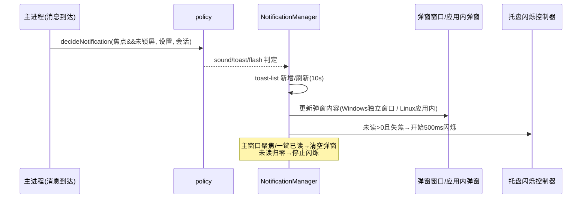

# 消息通知模块重构设计

日期：2026-11-19
状态：待评审

## 背景与目标

现有通知能力是散落的：右上角应用内小条 4 秒消失、任务栏 `flashFrame` 闪 6 秒就停、托盘图标只是静态换图、提示音是一段 0.35 秒的正弦波。本次重构把通知统一成三种方式，并补齐未读的可见性：

1. 屏幕右下角置顶通知弹窗
2. 托盘图标持续闪烁（直到未读清零）
3. 提示音（三个候选，默认 A，可切换）

外加一个未读悬停列表（微信式）和一键已读。

## 非目标

- 不做消息级的"暂不处理"状态；未读仍然只在会话级（`conversations.unread`）。
- 不改已读口径：点开会话即已读、发送永远不碰已读、窗口停在会话上但失去焦点时新消息仍算已读（已与需求方确认）。
- 不改系统通知渠道（`systemNotification` 设置）的开关、内容与点击跳转行为；唯一的变化是它的焦点抑制条件随新策略统一——前台有焦点时一律不弹（含其他会话），失去焦点时若该设置开启则照常弹出，与右下角弹窗并存。
- 不支持 macOS（仓库只发 Windows 与 Linux 包）。
- 不引入任何原生模块；保持"无原生依赖"约束。

## 需求方已确认的规则

### 触发矩阵

| 场景 | 未读累计 | 声音 | 弹窗 | 托盘闪烁 |
| --- | --- | --- | --- | --- |
| 前台有焦点（任何会话） | 是 | 否 | 否 | 否 |
| 失焦 / 最小化 | 是 | 是 | 是 | 未读 > 0 时是 |
| 锁屏（即使窗口有焦点） | 是 | 是 | 解锁后补显示完整 10 秒 | 是 |

- 前台有焦点时其他会话来消息：不弹、不响、不闪，但照常计入未读（悬停列表挂角标）。
- 锁屏是需求方明确要求的例外：锁屏期间视为失去焦点。
- 已读的唯一触发是"点开会话"。发送消息不产生任何已读效果。
- 系统通知渠道（`systemNotification` 设置）不在三种方式之内，开关语义不变：有焦点一律不弹，无焦点时若开启则与右下角弹窗同时出现（现状即如此，用户可在设置里关掉）。

### 通知弹窗

- 位置：屏幕右下角（工作区右下角，任务栏上方）。
- 置顶：始终盖在普通窗口之上。
- 显示 10 秒后自动消失；消失只影响弹窗本身，未读、角标、闪烁不受影响。
- 点击弹窗：恢复并聚焦主窗口，跳转到对应会话。
- 清除规则（对应"通知自动清除"）：
  - 主窗口获得焦点（用户回到软件查看）→ 清除全部弹窗。
  - 点击某个弹窗 → 跳转（聚焦主窗口，从而触发上一条，全部清除）。
  - 锁屏期间产生的弹窗先存起来，解锁后重新显示完整 10 秒；解锁瞬间由系统还回来的焦点事件不清除它们（解锁后 3 秒内的聚焦不执行"清除全部"）。
  - 一键已读 → 清除全部弹窗。
  - 同一会话连续来消息只刷新内容并重置计时，不叠加多个弹窗。
- 内容：会话标题 + 消息预览（一行截断）；文件通知沿用现有文案「收到文件：文件名」。
- 不满足走系统通知渠道的条件（Windows 系统通知约 5 秒就收进通知中心，且无法在"用户已查看"时程序化撤下），所以用独立置顶窗口。

### 托盘闪烁

- 未读图标显示 500 毫秒、隐藏 500 毫秒（隐藏用空图 `nativeImage.createEmpty()`），循环。
- 闪烁条件：未读总数 > 0 且主窗口无焦点且未锁屏，且设置 `notify.enabled`、`notify.flashTaskbar` 打开、不在勿扰时段。
- 停止条件：未读清零，或窗口获得焦点（暂停，失焦后若仍有未读恢复），或设置/勿扰状态变化。
- 勿扰时段边界靠一个 60 秒的周期性重算兜底（勿扰是纯时间窗口，事件驱动算不出来）。
- 现有的 `window.flashFrame(true)` 任务栏按钮闪烁与"闪 6 秒"的旧逻辑删除，三种通知方式以托盘闪烁为准。
- 闪烁状态由主进程统一驱动，渲染进程不参与。

### 未读悬停列表（仅 Windows）

- 触发：鼠标进入托盘图标（Electron `mouse-enter`，官方文档确认 Windows 支持，另有 `getBounds()` 可取图标位置）。去抖 120 毫秒后弹出。
- 形态：无边框、透明、置顶、不可获得焦点的小窗口，贴在托盘图标上方、屏幕右下角。窗口不抢焦点，点击正常送达。
- 内容：所有未读 > 0 的会话，按 `lastMessageAt` 倒序；每行头像、标题、红色未读数角标（>99 显示 99+）；底部一个「一键已读」按钮（对应微信截图里的「暂不处理」位置）。
- 点击条目：恢复并聚焦主窗口、跳转会话、收起列表。
- 收起条件：鼠标同时离开托盘图标和列表窗口（离开事件后延 200 毫秒用 `screen.getCursorScreenPoint()` 复查光标位置，允许光标移入列表）；未读清零；点击条目或一键已读。
- 没有未读时不弹。
- 悬停中收到新消息：列表内容实时刷新。
- 依赖 `mouse-enter`；实现时按真实行为验证，若不稳定按需求方决定整体移除该功能，只保留闪烁（不降级成左键点击弹出）。
- Linux 没有这些事件，不做悬停列表；托盘悬停提示文字（现有 tooltip 未读总数）保留。

### 一键已读

- 新 IPC `conversations.markAllRead()`：把所有未读 > 0 的会话置为已读（`unread = 0`、`last_read_message_id` 推到该会话最新消息），对私有会话补发已读回执（复用现有 `markRead` 的回执去重逻辑），逐会话发 `conversation` 事件刷新界面，未读总数归零（闪烁停止、Linux 角标清零），清除全部弹窗。
- 只从悬停列表按钮触发，主界面不加按钮。

### 提示音

- 三个候选全部保留，声音来源就是本次评审用的三个文件：
  - A（默认）：轻快两声上行，木琴质感——`candidate-a.wav`
  - B：柔和门铃两声下行，钟声泛音——`candidate-b.wav`
  - C：单声清脆高频，短促明亮——`candidate-c.wav`
- `scripts/gen-assets.py` 按 `.dev-data/sound-candidates/gen.py` 的合成参数生成 `notify-a.wav`、`notify-b.wav`、`notify-c.wav` 三个资源；删除旧的 `notify.wav`。
- 设置项 `notify.soundPreset: 'a' | 'b' | 'c'`，默认 `'a'`。
- 设置-通知区加「提示音」下拉（三项）和「试听」按钮（按当前音量播一遍所选提示音）。
- 音量沿用 `soundVolume`。
- 删除死配置 `soundFile`（全仓库只有 schema 定义，没有任何读取方；zod 对多余键是丢弃处理，老配置文件不受影响）。

## 通知策略（policy.ts）的改动

现状：只有"窗口有焦点 **且** 消息属于当前会话"才抑制通知；其他会话在前台也会弹、响、闪。

改为：**窗口有焦点（且未锁屏）就抑制声音、弹窗、闪烁，只保留未读计数**，与会话是否当前无关。

- `NotificationInput.windowFocused` 的语义变为"窗口焦点且未锁屏"，由 `NotificationManager` 在调用前合并锁屏状态。
- `activeConversationId` 不再参与判断，整条链路删除：策略入参、`NotificationManager.setActiveConversation`、`IPC.uiActiveConversation` 通道、preload 暴露、渲染进程的 `currentConversationId` 监听（`setActiveConversation` 原本只剩 `flashFrame(false)`，一并随闪烁重构删除）。
- 系统通知（`decision.system`）同样受焦点抑制：有焦点一律 `false`，其余门控照旧。
- 其余门控不变：`notify.enabled`、`muted`、勿扰时段、`notifyOnComplete`（文件）。

## 锁屏处理

- 主进程监听 `powerMonitor` 的 `lock-screen` / `unlock-screen`（Windows 生效）。
- 锁屏标志进入策略（视为无焦点）与闪烁条件。
- 锁屏期间新到的通知进"待显示"队列，不创建弹窗；解锁后统一显示、各自完整计时 10 秒；解锁后 3 秒内的窗口聚焦事件跳过"清除全部弹窗"。
- 声音在消息到达时当场播（锁屏下照样响）。
- Linux 不监听锁屏（`powerMonitor` 锁屏事件只有 Windows/macOS），视为从不锁屏——弱化项。

## 麒麟信安托盘图标排查

现象：托盘条目存在，但显示成系统默认图标（桌面环境收到了条目、加载不到我们的图像）。

已知线索：

- Electron 43.x 有一个 StatusNotifierItem 路由缺陷导致 Linux 托盘图标失效/异常，43.4.1 修复（electron/electron#52952）；本仓库 Electron 44 应已包含，先确认。
- ayatana appindicator 的老版本不接受 Electron 传的 `IconPixmap` 图像类型，回退默认图标（Ubuntu Budgie 等有同款问题报告）——麒麟信安桌面若是这种情况，属于宿主限制。

按顺序尝试的修复：

1. `gen-assets.py` 直接产出精确尺寸的 RGBA PNG，运行时不再 `resize()`：Windows 用 16×16（沿用现状，不动，避免无关的视觉回归）；Linux 产出 22×22 与 24×24 两套，先按现状试 22×22，麒麟信安第一轮无效再换 24×24 试第二轮。
2. 启动时把所用 PNG 复制到数据目录（`userData/icons/`，asar 之外的真实路径），`Tray` 用该路径创建——宿主进程按路径读图时读不了 asar 内部。
3. 仍不行则在麒麟信安上用 `busctl`/`dbus-send` 读 `org.kde.StatusNotifierItem` 的 `IconName`/`IconPixmap` 属性，确认 Electron 实际导出的是什么、宿主缺什么，再定下一步。

验证必须在麒麟信安上由需求方完成（本机无法复现）。若最终是宿主限制、应用侧无解，写进 `docs/known-limits.md`。

## Linux 弱化清单（稳定优先）

- 闪烁：照常调用 `setImage` 切换；宿主不刷新图标时无副作用。
- 悬停列表：不做。
- 弹窗：主窗口可见时用主窗口内右下角的应用内弹窗（10 秒、点击跳转、聚焦清除等规则与 Windows 相同），不开独立窗口。
- **主窗口隐藏时（关闭收到托盘、启动最小化）不出应用内弹窗**——把窗口硬拉出来会打断用户、还会触发"聚焦清除"把弹窗自己清掉；此时声音与托盘闪烁照常，系统通知渠道若开启则由它承担可见提醒（复用现有能力，不新增代码）。触发矩阵里"失焦/最小化 → 弹窗是"这一行只在 Windows 完整成立。
- 锁屏：不监听。

## 设置项汇总

| 设置 | 变化 |
| --- | --- |
| `notify.soundPreset` | 新增，`'a' \| 'b' \| 'c'`，默认 `'a'` |
| `notify.soundFile` | 删除（死配置） |
| `notify.flashTaskbar` | 保留，语义改为"托盘图标闪烁"，界面文案同步改 |
| `notify.inAppToast` | 保留，语义改为右下角通知弹窗的开关 |
| `notify.systemNotification` | 不动 |
| 其余 `notify.*` | 不动 |

## 代码改动点

| 位置 | 改动 |
| --- | --- |
| `src/main/notify/policy.ts` + 测试 | 焦点抑制改为全局；入参去 `activeConversationId`，`windowFocused` 合并锁屏 |
| `src/main/notify/manager.ts` | 删 `flashFrame` 与 6 秒闪烁；新增闪烁控制器、锁屏状态、弹窗存储与平台分发、焦点跟踪 |
| `src/main/notify/toast-list.ts`（新） | 弹窗列表的纯逻辑（新增/刷新/到期/清除规则），抽出便于单测 |
| `src/main/notify/toast-window.ts`（新，仅 Windows） | 独立置顶弹窗的创建、定位（工作区右下角、向上堆叠）、内容更新 |
| `src/main/notify/tray-popup.ts`（新，仅 Windows） | 悬停列表窗口的创建、定位（`tray.getBounds()` 上方）、显隐与光标复查 |
| `src/main/tray.ts` | 闪烁图元（未读图 ↔ 空图）、`mouse-enter`/`mouse-leave` 接线、暴露 `getBounds` |
| `src/main/index.ts` | 锁屏事件、窗口焦点事件、弹窗/列表窗口的创建与接线 |
| `src/main/app-service.ts` | `markAllRead`（复用回执去重）、锁屏与焦点状态传入通知管理器 |
| `src/main/store/repositories.ts` + 测试 | `markAllRead` 仓储方法 |
| `src/shared/ipc.ts`、`src/preload/index.ts` | `conversations.markAllRead` 通道；弹窗/列表窗口所需的数据与动作通道 |
| `src/shared/settings.ts` + 合并测试 | `soundPreset` 新增、`soundFile` 删除 |
| `src/renderer/src/App.vue` | 弹窗样式移到右下角、10 秒计时、聚焦清除、按 `soundPreset` 选音源；用查询参数分支渲染弹窗窗口与悬停列表窗口（单入口，不加构建配置） |
| `src/renderer/src/components/SettingsOverlay.vue` | 提示音下拉 + 试听；`flashTaskbar` 文案 |
| `scripts/gen-assets.py` | 三个提示音、精确尺寸托盘图标 |

## 数据流

## 测试与验证

单测（Vitest，仅 Node 侧）：

- `policy.test.ts`：前台有焦点对任意会话只保留未读计数；锁屏视为失焦；勿扰/静音/文件门控回归。
- `toast-list.ts`：同会话刷新重置计时、到期移除、聚焦清除、一键已读清除、锁屏队列与解锁释放。
- `repositories.test.ts`：`markAllRead` 推进水位线、多会话、无未读会话跳过。
- 设置：`soundPreset` 默认值、`soundFile` 删除后旧配置可读。

端到端（CDP 脚本，全部带超时）：

- 弹窗窗口：位置在工作区右下角、10 秒自动消失、点击跳转会话、主窗口聚焦后清除。
- 悬停列表窗口：直接以窗口地址打开验证内容渲染、点条目跳转、一键已读归零收起。
- 按提示音切换后 `Audio` 音源正确（代码层断言）。

人工验证清单（无法自动化的部分）：

- Windows：鼠标悬停托盘弹列表、光标移入列表不消失、移开后收起；闪烁节奏与停止时机；锁屏 → 解锁补显示弹窗；三个提示音试听。
- 麒麟信安：托盘图标显示（按排查步骤逐项验证）。
- Linux 常规桌面：闪烁是否生效（不生效不阻塞发版）。

## 留给实现者的细节

- 悬停列表与弹窗窗口的数据通道：优先复用现有会话快照与头像加载通道；若快照通道耦合主窗口状态，新增轻量 IPC 取未读行（id、标题、未读数、头像键）。
- 独立窗口用单一 `index.html` 加查询参数分支渲染（`?window=toast`、`?window=tray-popup`），不引入多页构建配置。
- 弹窗窗口 `focusable: false` + `alwaysOnTop` + `skipTaskbar` + 透明无边框；点击送达依赖该组合，实现时验证点击确实触发。
- 堆叠定位按 `screen.getPrimaryDisplay().workArea` 计算，多条弹窗向上排列，间距 8px。
- 闪烁状态重算的触发点：未读变化、焦点变化、锁屏变化、设置保存、60 秒周期（兜底勿扰边界）。
- 已读回执去重：`markAllRead` 必须走 `markRead` 同一条回执路径，避免重复回执。
